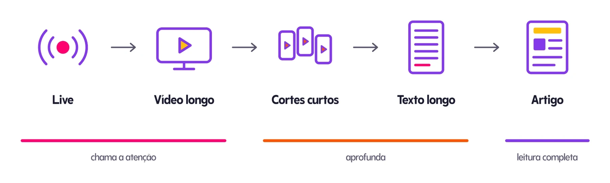

A reunião do grupo termina com uma decisão: "vamos abrir um Instagram". Alguém cria o perfil, publica três posts sobre o último artigo e, quatro meses depois, a conta está parada. Faltou combinar antes com quem o grupo queria falar, o que essas pessoas deveriam levar da conversa e quantas horas por semana cada um tinha para isso.

Quem decide divulgar pesquisa científica nas redes sociais costuma começar pela plataforma. Este texto propõe começar pelo formato: vídeo curto, vídeo longo, podcast, carrossel, texto curto ou texto longo. Cada formato pede um tipo de esforço, alcança pessoas diferentes e depende do algoritmo em graus diferentes. As ideias vêm do minicurso "Plataformas digitais a seu favor", que ministrei no VII Semidiscom (PPGCOM/UFRGS) em outubro de 2026, e dos estudos que usamos como base na Seja Creator.

## Para quem você está falando: divulgação ou comunicação científica?

[Divulgação científica](/blog/o-que-e-divulgacao-cientifica/) é o trabalho de levar a pesquisa a quem está fora da área. Bueno (2010, p. 5) a define como o esforço de "democratizar o acesso ao conhecimento científico" e de incluir os cidadãos no debate sobre temas especializados que afetam a vida deles. A comunicação científica, na mesma distinção, é a circulação de informação especializada entre pares: artigos, repositórios, preprints, Lattes, Google Acadêmico.

Essa diferença muda a escolha do formato. Para ser encontrado por colegas da área, os canais acadêmicos já fazem boa parte do trabalho. Para chegar a professores da educação básica, a gestores públicos ou a quem vive o problema que você estuda, o conteúdo precisa ir até onde essas pessoas estão. Nas plataformas comerciais, como Instagram, TikTok e YouTube, o algoritmo premia o que prende a atenção e alcança muita gente. Os pares também estão lá, mas deixam de ser o centro da conversa.

## Por que pensar no formato antes da plataforma?

O formato dura mais que a plataforma, porque as plataformas copiam umas às outras. Os stories nasceram no Snapchat e se espalharam pelo Instagram. O vídeo curto vertical do TikTok virou Reels e Shorts. O Threads seguiu o modelo do X. O podcast ganhou câmera e virou videocast.

Escolher primeiro o formato protege o trabalho do grupo. Um roteiro de vídeo curto serve no Reels, no Shorts e no TikTok. Se uma plataforma muda as regras ou perde público, o formato continua de pé, e a equipe não precisa recomeçar do zero.

## Seis formatos e o que cada um pede

Os formatos mais usados para divulgar pesquisa nas plataformas são seis. Eles diferem em onde aparecem, no que fazem bem e no esforço que pedem de quem pesquisa.

| Formato | Onde aparece | Bom para | O que pede de você |
|---|---|---|---|
| Vídeo curto vertical | TikTok, Reels, Shorts, Kwai | despertar interesse em quem ainda não conhece o seu trabalho | gancho nos primeiros segundos, uma ideia só, tom de conversa |
| Vídeo longo | YouTube, Spotify, LinkedIn | explicar a pesquisa inteira e virar referência num tema | título e capa que prometem o que o vídeo cumpre, estrutura em blocos |
| Podcast e videocast | Spotify, YouTube, Apple Podcasts | aprofundar com tempo e conversar com outros pesquisadores | constância, boa pauta, boa conversa |
| Carrossel | Instagram, LinkedIn, TikTok | explicar em etapas, mostrar dados, ser salvo para consulta | capa que faz parar de rolar a tela, uma ideia por tela, identidade visual |
| Texto curto e thread | Threads, Bluesky, X, LinkedIn, canais de WhatsApp | reagir a notícias e conversar com jornalistas e pares | primeira frase que funcione sozinha, disposição para responder |
| Texto longo | newsletter, blog, Medium | aprofundar e levar ao artigo completo | constância e argumento bem estruturado |

Há alguma evidência para orientar essas escolhas, quase toda sobre vídeo. Uma revisão de 28 estudos sobre vídeos de divulgação científica no YouTube e no TikTok encontrou que vídeos com legenda tiveram mais visualizações e compartilhamentos, que perfis de pessoas influenciam mais que perfis de organizações e que, no TikTok, a referência fica em torno de um minuto para vídeos expositivos (Lai et al., 2025). Sobre o vídeo longo, um estudo com os dados internos de um canal de química no YouTube mostrou que cerca de 92% das visualizações vinham de quem não era inscrito. Os inscritos, porém, curtiam cerca de 13 vezes mais por visualização e assistiam a uma parte maior de cada vídeo (Yang et al., 2022). Quem acompanha o trabalho de forma contínua se envolve muito mais do que quem chega por acaso.

## O que a plataforma favorece em cada formato

Cada formato depende do algoritmo num grau diferente, e isso conta na escolha. YouTube, Instagram e TikTok são, antes de tudo, plataformas de publicidade, que se sustentam vendendo a atenção de quem as usa (Srnicek, 2016). O algoritmo trabalha para manter as pessoas diante da tela, e circula com mais facilidade o conteúdo que serve a esse objetivo.

O vídeo curto é o formato que mais depende da recomendação: chega a quem não segue o perfil, e a decisão de continuar assistindo acontece nos primeiros segundos. É também onde a tensão entre precisão e comunicação aperta mais. O vídeo longo pode ser encontrado pela busca durante anos, mas a vitrine passa pelo crivo da plataforma. Na minha pesquisa de mestrado, uma busca por termos centrais do debate político brasileiro nos metadados de 1.049 vídeos populares do YouTube teve incidência nula ou irrelevante (Severo, 2026).

O podcast nasceu aberto, distribuído por RSS, e as plataformas tentam trazê-lo para dentro delas com o videocast e com conteúdos exclusivos. Para quem começa, a descoberta depende muito de indicação e de cortes publicados em outras redes. No carrossel, a estética vira critério de circulação, e quem não tem apoio de design sai em desvantagem. No texto curto, a polêmica tende a circular mais que a nuance, e nos canais de mensagem a fonte precisa ir junto quando o conteúdo é encaminhado.

O texto longo enviado por e-mail é o formato menos dependente do algoritmo, porque a lista de leitores pertence a quem escreve. Essa é uma leitura nossa, sem estudo comparativo por trás, mas ajuda a pensar onde guardar a relação com o público.

Vale lembrar que o alcance nas plataformas é muito concentrado. No YouTube, 85% das visualizações ficam com 3% dos canais (Bärtl, 2018). Tomar os maiores canais como meta é aceitar as regras que a plataforma definiu para os próprios interesses.

## Os formatos se alimentam

Um mesmo conteúdo pode circular em vários formatos, cada um com um papel. Uma live vira vídeo longo, o vídeo longo rende cortes curtos, os cortes levam a um texto mais longo, e o texto leva ao artigo. Os formatos curtos chamam a atenção, os longos aprofundam, e o artigo recebe quem quer saber tudo.

O [Café História](https://cafehistoria.com.br/about), portal do historiador Bruno Leal (UnB), no ar desde 2008, mostra como um formato bem escolhido se sustenta. O site declara para quem escreve, adultos que não são historiadores e se interessam por política e sociedade, e mantém uma rotina de um texto original por semana. O próprio portal descreve o desafio de fazer conteúdo acessível "com rigor acadêmico" (CAFÉ HISTÓRIA, 2026).

O [Nós da Docência](/#historias) é uma das histórias que ajudamos a contar. É o ecossistema da pesquisadora Maria Cláudia Dal'Igna (Unisinos) sobre a profissão docente, com livro, podcast, formações, redes sociais e uma plataforma de educação continuada, todos partindo da mesma pesquisa. A Seja acompanha o projeto desde 2024: a pesquisadora escreve e fala, e a gente cuida de formato, edição, design e comunidade. Entre 2021 e 2025, segundo os dados do projeto, o Nós da Docência somou mais de 70 mil visualizações nas plataformas, mais de 500 livros vendidos e mais de 4 mil pessoas em formações. Desses números, as visualizações são os que menos dizem. O resultado mais valioso é uma comunidade de professoras e professores que voltam, participam e levam a pesquisa para a sala de aula.

## Na prática: perguntas para responder antes de escolher

Antes de abrir uma conta ou gravar o primeiro episódio, vale responder por escrito a algumas perguntas. Elas são a base da dinâmica que usamos nas formações da Seja.

1. **Qual é a sua pesquisa em uma frase?** Se ela não cabe numa frase, ainda não está pronta para nenhum formato.
2. **Para quem é esse conteúdo?** "Professores da rede pública de Porto Alegre" orienta muito mais que "o público em geral".
3. **Para quê?** Dar acesso ao conhecimento, entrar num debate público, formar pessoas, construir uma comunidade ou ser encontrado por pares.
4. **Por que esse formato?** O que ele faz por esse público que os outros não fazem?
5. **Qual é a trilha?** Se alguém gostar do conteúdo, para onde vai depois?
6. **Quanto tempo você tem por semana?** Um formato que o grupo não consegue manter vira mais uma tarefa atrasada numa rotina que já tem aula, orientação e pesquisa.

Na nossa experiência, começar com um formato bem cuidado e uma trilha clara rende mais do que abrir perfis em todas as plataformas ao mesmo tempo.

## Limites: o que ainda não se sabe

A evidência sobre formatos de divulgação científica ainda é estreita. Na revisão de Lai et al. (2025), 89,3% dos estudos são dos Estados Unidos, e o Instagram, onde está boa parte dos pesquisadores brasileiros, aparece em um único estudo. Sobre podcast e sobre o Brasil, quase não há dados nos estudos que usamos.

O que se mede também é limitado. Os estudos contam visualizações, curtidas e compartilhamentos, e quase nunca verificam se as pessoas entenderam a pesquisa ou passaram a confiar nela. O estudo de Yang et al. (2022) analisa um único canal, com dados de 2014 a 2017, anteriores aos Shorts. As plataformas mudam regras e formatos com frequência, então as escolhas propostas aqui são pontos de partida para testar com o seu público.

## O formato a serviço da pesquisa

Escolher um formato é uma decisão sobre a pesquisa, sobre as pessoas que você quer alcançar e sobre o tempo de quem pesquisa, e ela vem antes da escolha da plataforma. As plataformas têm interesses próprios e premiam o que serve a elas. Saber o que cada formato pede e o que cada plataforma favorece permite usá-las com consciência, sem entregar a elas a decisão sobre o que a sua pesquisa precisa dizer.

Se o seu grupo está pensando em quais formatos fazem sentido para a pesquisa, [a gente pode ajudar a desenhar esse ecossistema](/#o-que-fazemos).

## Referências

BÄRTL, Mathias. YouTube channels, uploads and views: a statistical analysis of the past 10 years. **Convergence**, v. 24, n. 1, p. 16-32, 2018. DOI: [10.1177/1354856517736979](https://doi.org/10.1177/1354856517736979).

BUENO, Wilson da Costa. Comunicação científica e divulgação científica: aproximações e rupturas conceituais. **Informação & Informação**, Londrina, v. 15, n. esp., p. 1-12, 2010. DOI: [10.5433/1981-8920.2010v15nesp.p1](https://doi.org/10.5433/1981-8920.2010v15nesp.p1).

CAFÉ HISTÓRIA. **Sobre**. [S. l.], [2026]. Disponível em: [https://cafehistoria.com.br/about](https://cafehistoria.com.br/about). Acesso em: 22 out. 2026.

LAI, Betty S.; RIOBUENO-NAYLOR, Alexa; QUAN, Sarah; MONTES, Mauricio; WARGO, Jon; JONES-JANG, Mo. Evaluating video-based science communications practices: a scoping review. **Journal of Science Communication**, v. 24, n. 3, V01, 2025. DOI: [10.22323/2.24030901](https://doi.org/10.22323/2.24030901).

SEVERO, Filipe Machado Leal. **O novo "you" do YouTube**: a ascensão dos produtores plataformizados e a falência da promessa participativa no Brasil. 2026. Dissertação (Mestrado em Comunicação Social) – Programa de Pós-Graduação em Comunicação Social, Pontifícia Universidade Católica do Rio Grande do Sul, Porto Alegre, 2026.

SRNICEK, Nick. **Platform capitalism**. Cambridge: Polity Press, 2016.

YANG, Shiyu; BROSSARD, Dominique; SCHEUFELE, Dietram A.; XENOS, Michael A. The science of YouTube: what factors influence user engagement with online science videos? **PLoS ONE**, v. 17, n. 5, e0267697, 2022. DOI: [10.1371/journal.pone.0267697](https://doi.org/10.1371/journal.pone.0267697).

